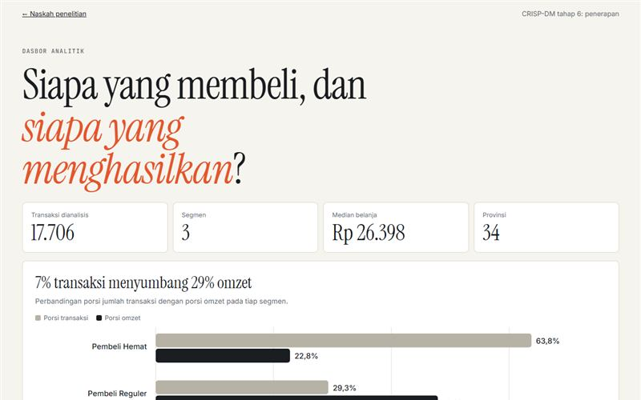

# Segmentasi Pelanggan E-Commerce

Penelitian CRISP-DM yang membandingkan K-Means dan K-Medoids, dengan dasbor interaktif.

**Demo:** https://portofolio-jauza-fawaid.netlify.app/SIDANG-SEGMENTASI/

Penelitian CRISP-DM yang membandingkan K-Means dan K-Medoids pada 17.706 transaksi toko Shopee, dengan dasbor interaktif sebagai tahap penerapan.

## Hasil

| Metrik pada K = 3 | K-Means | K-Medoids |
|---|---|---|
| RMSE | 1,144 | 1,253 |
| Silhouette | 0,404 | 0,232 |
| Davies-Bouldin | 1,005 | 1,140 |

K-Means menang pada 20 dari 21 perbandingan. Tiga segmen yang dihasilkan: Pembeli Hemat (63,8%), Pembeli Reguler (29,3%), dan Pelanggan Grosir Premium (7,0%). Segmen terakhir menyumbang 29,4% omzet.

## Menjalankan

Buka `index.html` untuk naskah dan `dashboard.html` untuk dasbor. Tidak perlu server.

## Isi

- `data/segmen.js`: agregat dan sampel 1.200 transaksi tanpa ID pesanan
- `img/`: grafik asli dari notebook penelitian

## Teknologi

Python, pandas, scikit-learn, SciPy, Matplotlib, JavaScript, SVG
